# Does Sarcasm Supervision Help? A Leakage-Controlled, Explainable Study of Cyberbullying-Type Detection in Hinglish

*Working title in the brief: "SACENet: Sarcasm-Aware Explainable Detection of Cyberbullying in Hinglish Text". The
title was revised because the evidence supports a controlled evaluation of sarcasm-aware components rather than a
validated new detector, and because early detection was evaluated only on a proxy dataset.*

*Authors: [to be added by the project owner]. Draft generated from saved experimental results on 2026-10-18.*

## Abstract

Cyberbullying on Indian social media is often written in Hinglish, a Roman-script mixture of Hindi and English, and
is often indirect: mockery and sarcasm stand in for explicit insults. We study whether sarcasm knowledge, learned from a
separate human-annotated Hinglish sarcasm corpus, improves seven-way cyberbullying-type classification on
MC-Hinglish1.0, and whether token-level explanations of the resulting models are faithful. Under a leakage-controlled
protocol with three seeds per configuration, a fine-tuned MuRIL encoder reaches a test macro-F1 of
0.632 ± 0.016, against
0.743 for a character-n-gram TF-IDF SVM. Multitask sarcasm supervision shows no reliable difference from the base model (Δ macro-F1 = +0.006, 95% CI [-0.014, +0.026]), and a shuffled-label control performs as well as real sarcasm labels (Δ = -0.002), so the sarcasm labels themselves add nothing measurable. Feature fusion with a separately trained sarcasm model shows no reliable difference from the base model (Δ = +0.007, 95% CI [-0.013, +0.026]). A Hinglish-pretrained encoder (HingRoBERTa) is the only transformer that approaches the TF-IDF baselines. We also find
that 182 of the 1,000 official test items (18.2%) have near-duplicates in the training split, and
that the sarcasm corpus's retrieval hashtags leak its labels; both would inflate reported scores if left unaddressed.
SHAP attributions pass a deletion-based faithfulness test (deleting the top-attributed word lowers the predicted-class probability by 0.421 vs. 0.092 for a random word). A causal early-warning
procedure, evaluated only on English in-game chat as a proxy, flags toxic conversations with alarm F1 0.913 at a 0.051 false-alarm rate, but almost always at the first toxic turn rather than before it. Code, split identifiers and
per-item predictions are released for verification.

**Keywords:** cyberbullying detection; code-mixing; Hinglish; sarcasm; multitask learning; explainability; SHAP; reproducibility

## 1. Introduction

Automated detection of cyberbullying and abusive language has been studied for more than a decade
(Salawu et al., 2020; Van Hee et al., 2018; Fortuna and Nunes, 2018), mostly for English. In India, a large share of
social-media communication is code-mixed: users alternate between Hindi and English within a sentence and usually write
Hindi in Roman script without standard spelling (Khanuja et al., 2020; Bohra et al., 2018). This creates three
difficulties for detection models. Vocabulary is sparse because the same Hindi word appears in many transliterations;
pretrained encoders see comparatively little romanised Hindi; and cyberbullying is often *indirect*, mocking a target
through exaggerated praise or irony rather than explicit slurs (Joshi et al., 2017).

Sarcasm is therefore a natural candidate for auxiliary knowledge. It is also hard to supply honestly: we are not aware of
a public Hinglish corpus that annotates both cyberbullying and sarcasm on the same texts. Sarcasm signals must come from a
*different* corpus, and whether they transfer is an empirical question, not something to assume. A common
shortcut—deriving "sarcasm" labels from a cyberbullying category such as *mockery* or from surface cues—makes any
measured benefit circular. The prototype that preceded this work did exactly that (Section 5.4).

Explainability matters because moderation decisions affect people. Attribution methods such as SHAP
(Lundberg and Lee, 2017) can show which words a model relied on. However, attributions describe model behaviour, not
author intent, and they are not guaranteed to be faithful to the model (Jacovi and Goldberg, 2020). We therefore
*test* faithfulness rather than assume it.

Finally, the original motivation included *early* detection of escalating cyberbullying in conversations
(López-Vizcaíno et al., 2021). Validating that requires real conversations with turn-level labels. We found no openly
available Hinglish dataset of this kind. We therefore evaluate the early-warning mechanism on CONDA (Weld et al., 2021),
an English in-game chat corpus with turn-level toxicity labels, and describe it explicitly as a proxy study.

**Research questions.**

- **RQ1.** How do classical and transformer models (multilingual vs. Hinglish-specific) compare on MC-Hinglish1.0 under leakage-controlled splits?
- **RQ2.** Does sarcasm supervision from a separate human-annotated Hinglish corpus improve cyberbullying-type classification, and is any gain attributable to the sarcasm *labels* rather than to additional auxiliary data?
- **RQ3.** Are SHAP explanations of the resulting model faithful and stable?
- **RQ4.** In a proxy setting, how early and with how many false alarms can a causal turn-level detector flag toxic conversations?

## 2. Related Work

**Cyberbullying and abusive language.** Surveys cover feature-based and neural detectors
(Salawu et al., 2020; Fortuna and Nunes, 2018). Van Hee et al. (2018) address fine-grained cyberbullying
detection, and Vidgen and Derczynski (2020) show how sampling and annotation choices shape abusive-language datasets,
which is one reason we do not merge datasets with different label definitions. Sap et al. (2019) document
dialect-correlated label bias. Widely used benchmarks include OLID (Zampieri et al., 2019) (also distributed in
TweetEval; Barbieri et al., 2020), HASOC (Mandl et al., 2019), TRAC (Kumar et al., 2018; Kumar et al., 2020)
and HateXplain (Mathew et al., 2021).

**Hinglish and code-mixed NLP.** Bohra et al. (2018) released Hinglish hate-speech annotations, and GLUECoS
(Khanuja et al., 2020) benchmarks code-switched NLP. MuRIL (Khanuja et al., 2021) is pretrained on 17 Indian
languages including transliterated text, and the L3Cube HingBERT family (Nayak and Joshi, 2022) is pretrained on
Hinglish. MC-Hinglish1.0 (Rahman-Laskar et al., 2024) annotates seven cyberbullying types. Its authors report classical
models and a voting ensemble at 0.609 accuracy on the official split. Kumar (2025) combine MuRIL with
attribution analysis on six other Hinglish datasets, so we do not claim that combination as new.

**Sarcasm.** Joshi et al. (2017) survey sarcasm detection. For Hinglish, Swami et al. (2018) release 5,250
annotated tweets, Aggarwal et al. (2020) release a further corpus and use bilingual embeddings, and
Majumder and Sen (2026) find that a small fine-tuned model can outperform prompted LLMs. Multitask learning
(Caruana, 1997; Ruder, 2017) has been used to share sentiment and sarcasm information
(Majumder et al., 2019).

**Explainability.** LIME (Ribeiro et al., 2016), SHAP (Lundberg and Lee, 2017) and Integrated Gradients
(Sundararajan et al., 2017) are standard attribution methods. ERASER (DeYoung et al., 2020) operationalises
faithfulness via comprehensiveness and sufficiency, and Jacovi and Goldberg (2020) discuss what faithfulness can
and cannot establish.

**Early detection.** eRisk introduced latency-weighted evaluation (ERDE; Losada and Crestani, 2016).
López-Vizcaíno et al. (2021) study early cyberbullying detection on social-network sessions, and
Hosseinmardi et al. (2015) annotate Instagram media sessions. CONDA (Weld et al., 2021) provides
conversation-structured in-game chat with utterance-level toxicity intents.

## 3. Research Gap and Contributions

Combining a multilingual encoder with a sarcasm signal, SHAP and early detection is not novel in itself. Our
contributions are evidential and methodological:

1. **A leakage-audited benchmark protocol for MC-Hinglish1.0.** We quantify near-duplicates between the official train
   and test splits (182 test items), report results on both the official and a de-duplicated test
   set, and release split identifiers.
2. **A controlled test of sarcasm transfer.** We compare multitask learning with a *shuffled-label* control and with
   feature fusion, after identifying and removing a retrieval-hashtag artefact in the sarcasm corpus. We also re-evaluate
   the prototype's hand-set "sarcasm boost" rule using a trained sarcasm model.
3. **Faithfulness and stability checks of SHAP explanations** for a Hinglish abuse classifier.
4. **A clearly scoped proxy evaluation of causal early warning** with delay, false-alarm and ERDE metrics.

## 4. Problem Formulation

Let $x$ be a comment. **MC7** is the original seven-way task: predict $y \in \mathcal{Y}$, with $\mathcal{Y}$ =
{not\_cyberbullying, age, gender, religion, mockery, abusive, offensive}. **MC2** is the derived binary task
$b=\mathbb{1}[y\neq\texttt{not\_cyberbullying}]$; the derivation is justified because the dataset defines the six
other labels as types of cyberbullying. Sarcasm detection is the auxiliary task: predict $s\in\{0,1\}$ on a separate
corpus. For early detection, a conversation $(u_1,\dots,u_n)$ has turn labels $z_t\in\{0,1\}$ and is positive if
$\exists t: z_t=1$, with onset $o=\min\{t: z_t=1\}$. After each turn, a detector emits $p_t=f(u_{\le t})$, which
depends only on turns observed so far, and raises an alarm at $\hat t=\min\{t: a_t\ge\tau\}$ with
$a_t=\max_{s\le t}p_s$.

## 5. Datasets

**Datasets used in this study (records after validation).**

| Dataset | Language | Unit | Labels | Records | Licence | Role |
|---|---|---|---|---|---|---|
| MC-Hinglish1.0 | hi-en (Roman) | comment | 7 cyberbullying types | 8,400 | CC-BY-NC-SA-4.0 | train / val / test |
| Swami et al. sarcasm | hi-en (Roman) | tweet | sarcastic / not | 5,250 | GPL-3.0 | sarcasm supervision |
| CONDA | en | chat turn | E / I / A / O intent | 35,895 | not stated | early-detection proxy |
| TweetEval-Offensive (test) | en | tweet | offensive / not | 860 | OLID terms | external stress test |
| User sarcasm file (human labels) | hi-en | comment | sarcastic / not | 8,455 | unknown | supplementary test (provenance unknown) |

### 5.1 MC-Hinglish1.0

MC-Hinglish1.0 (Rahman-Laskar et al., 2024) contains 8,400 Roman-script Hinglish Twitter comments (7,400 train /
1,000 test). The class sizes are near-balanced (1,104–1,145 per cyberbullying type) except for not\_cyberbullying
(1,691). The release reports neither the number of annotators nor inter-annotator agreement. Our local copy is
byte-identical to the public release (SHA-256 verified). We carve a stratified 10% validation split (741 items) from
the official training split and keep the official test split unchanged (Table \ref{tab:splits}).

**Train–test overlap.** Using character 3–5-gram TF-IDF cosine similarity ≥ 0.9, 182 test items
(18.2%) have a near-duplicate in the official training split; 38 are duplicates after case/punctuation/repetition
normalisation and 4 are exact. We keep the official test split for comparability and also report every result on the
818-item de-duplicated subset. Our validation split is grouped by near-duplicate cluster and has zero
overlap with training data (Table \ref{tab:quality}).

### 5.2 Sarcasm corpus

The corpus of Swami et al. (2018) contains 5,250 Hinglish tweets (504 sarcastic, 9.6%) with token-level language
tags (romanised Hindi 75%, English 10% of tagged tokens; mean code-mixing index 11.8). **Retrieval artefact:** 486 of
the 504 sarcastic tweets contain `#sarcasm` or `#irony`, the hashtags used to collect them, while non-sarcastic tweets
carry topical query hashtags. With hashtags kept, a TF-IDF logistic regression reaches 0.879 macro-F1; after removing all
hashtags it reaches 0.739. All `#` tokens are removed from the model input, and we split 70/10/20 with stratification
and near-duplicate grouping.

### 5.3 CONDA (proxy for early detection)

CONDA (Weld et al., 2021) contains English Dota 2 chat with utterance-level intents (explicit toxicity E, implicit
toxicity I, action A, other O); we define toxic = E ∪ I. The official train/validation files split conversations
*per utterance*: 3,540 conversations occur in both files. We therefore pool the 35,895 annotated utterances (10,902
conversations) and re-split by match, giving 7,726 / 1,089 / 2,087 conversations for train / validation / test.
Conversations are short (median 2 turns), and turns from the unannotated official test file are missing.

### 5.4 Data not used

HASOC and TRAC require registration with the organisers, and the Bohra et al. data ships tweet IDs only. Two
user-supplied sarcasm files have undocumented provenance. Their LLM-generated labels agree with the accompanying human
labels on only 52.9% of items, so they are never used as ground truth. The human labels serve only as a supplementary
cross-corpus test. The prototype's "sarcastic" field for MC-Hinglish (mockery label or regex cue) was discarded as
circular.

**Data-quality and leakage audit (measured).**

| Check | Value |
|---|---|
| official train: exact-duplicate groups | 8 |
| official train: normalised-duplicate groups | 250 |
| official train: near-duplicate pairs (cos >= 0.9) | 1,082 |
| label conflicts among exact duplicates | 0 |
| test items with near-duplicate in official train | 182 |
| our train<->val near-duplicate pairs | 0 |
| Swami sarcastic tweets containing #sarcasm/#irony | 486 / 504 |
| CONDA conversations split across official train/valid files | 3,540 |

## 6. Methodology

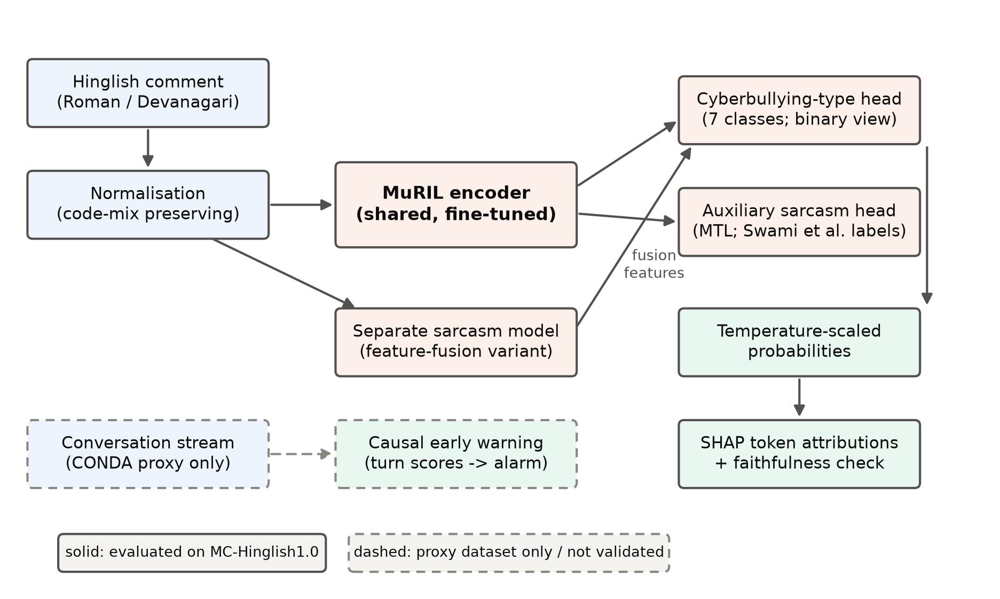

*Figure (fig:system). SACENet system overview. Solid components were trained and evaluated on MC-Hinglish1.0. The dashed early-warning path was evaluated only on the English CONDA proxy.*

### 6.1 Preprocessing

Text is NFC-normalised. Case, punctuation, Devanagari and code-switching are preserved. Emoji are mapped to their CLDR
names, because MuRIL's vocabulary maps many emoji to [UNK]. URLs and user mentions become placeholders, and character
elongations are capped at three repetitions. Class imbalance is handled with inverse-frequency class weights computed on
the training split only; no resampling is used.

### 6.2 Baselines

We train a majority-class predictor and linear models on word 1–2-gram plus character 2–5-gram TF-IDF features: logistic
regression, and a linear SVM with Platt scaling fitted by 5-fold cross-validation within the training split. The
regularisation strength $C\in\{0.1,0.3,1,3,10\}$ is selected on validation macro-F1.

### 6.3 Transformer classifiers

We fine-tune MuRIL (Khanuja et al., 2021), XLM-R base (Conneau et al., 2020) and HingRoBERTa (Nayak and Joshi, 2022)
with a linear head on the first-token representation $h$:

$$\hat{y}=\mathrm{softmax}(W\,\mathrm{dropout}(h)+b),\qquad \mathcal{L}_{\mathrm{CB}}=-\sum_i w_{y_i}\log \hat{y}_{i,y_i}$$

where $w_c$ are the training-split inverse-frequency weights normalised to mean 1.

### 6.4 Sarcasm-aware variants

**Multitask learning (MTL).** A second linear head on the same encoder predicts sarcasm on Swami-corpus batches,
and both losses are optimised jointly:

$$\mathcal{L}=\mathcal{L}_{\mathrm{CB}}+\lambda\,\mathcal{L}_{\mathrm{sarc}},\qquad \lambda=0.5$$

with one auxiliary batch per main batch (the smaller auxiliary set is cycled).

**Shuffled-label control.** The control is identical to MTL, except that the sarcasm labels are permuted once at random
(the class ratio is kept). If MTL improves over the base model only because of extra text or regularisation, the
control should improve equally.

**Feature fusion.** A separately trained MuRIL sarcasm detector is frozen. For every comment, its probability
$p_{\mathrm{sarc}}$ and pooled embedding $e$ are projected as $\phi=\mathrm{GELU}(W_\phi[p_{\mathrm{sarc}};e])\in\mathbb{R}^{64}$
and concatenated with $h$ before the cyberbullying head.

**Prototype boost rule.** The earlier prototype raised the binary bullying probability as
$p'=\min(1,p+0.18\,s)$ when $s\ge0.45$, with decision threshold 0.55. We re-evaluate this rule on MC2, using the
trained sarcasm detector's $s$.

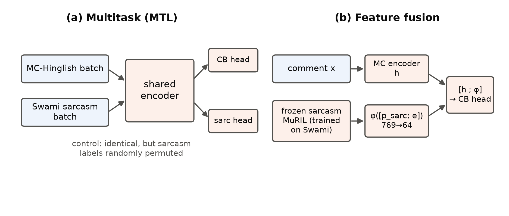

*Figure (fig:sarcasm). Sarcasm components: (a) multitask learning with a shuffled-label control; (b) feature fusion with a frozen, separately trained sarcasm model.*

### 6.5 Explanations and their checks

We explain the predicted-class probability with the SHAP Partition explainer and a tokenizer-based text masker, then
sum subword attributions per word. *Faithfulness* is measured with a deletion test in the spirit of ERASER
comprehensiveness (DeYoung et al., 2020): the drop in the predicted-class probability after deleting the top-$k$
attributed words is compared with deleting $k$ random words. *Stability* is measured as the rank agreement across SHAP
evaluation budgets and with leave-one-word-out occlusion.

### 6.6 Early-warning procedure (proxy)

Turn scorers are TF-IDF logistic regression and DistilRoBERTa, each trained on CONDA training turns with or without the
two preceding turns as causal context. The alarm threshold $\tau$ maximises conversation-level F1 on validation
conversations. A second operating point caps the validation false-alarm rate at 10%.

## 7. Experimental Setup

All transformers share one hyperparameter setting (Table \ref{tab:hparams}): encoder learning rate $3\times10^{-5}$ and
head learning rate $10^{-3}$ with linear warm-up (10%) and decay, AdamW (Loshchilov and Hutter, 2017) with weight decay 0.01, batch size 32, at most 5 epochs with
early stopping (patience 2) on validation macro-F1, gradient clipping at 1.0, and maximum length 128 tokens. Each
configuration is trained with seeds 13, 42 and 87. Training used an Apple M1 Pro GPU through PyTorch's MPS backend in
fp32; fp16 autocast was measured to be slower on this hardware. Because the optimiser update of MuRIL's
151M-parameter token-embedding table dominated step time, **the token-embedding table is frozen for all transformer
models**, while position embeddings and all encoder layers are fine-tuned. Pretrained weights are pinned to exact Hub
revisions. **Tuning disclosure.** An initial configuration (learning rate $3\times10^{-5}$ for encoder and head)
under-fitted. For MuRIL on MC7, validation loss was 1.41 after five epochs, the fitted temperature was 0.23, and the
test macro-F1 (0.662) was far below the validation macro-F1 (0.774). Observing this test result prompted a small pilot,
which used validation data only (encoder learning rate $\in\{3,5\}\times10^{-5}$, head $10^{-3}$, one seed). The
$5\times10^{-5}$ setting was best on MC7 validation, but it collapsed to the majority class on the sarcasm task. We therefore
fixed the best setting that was stable on every task's validation data ($3\times10^{-5}$ / $10^{-3}$) for all models and
tasks. Because the decision to tune was triggered by a test
observation, the test set is not perfectly untouched; we report this rather than hide it. Implementation uses PyTorch, Transformers (Wolf et al., 2020), scikit-learn
(Pedregosa et al., 2011) and SHAP.

**Model configurations and hyperparameters (shared across models).**

| Setting | Value |
|---|---|
| max_len | 128 |
| batch_size | 32 |
| freeze_word_embeddings | True |
| lr | 3e-05 |
| head_lr | 0.001 |
| epochs | 5 |
| patience | 2 |
| warmup | 0.1 |
| weight_decay | 0.01 |
| clip | 1.0 |
| dropout | 0.1 |
| class_weighting | True |
| amp | False |
| optimiser | AdamW (fused), linear warm-up/decay |
| seeds | 13, 42, 87 |
| MTL lambda | 0.5 |
| model selection | best validation macro-F1 epoch |
| TF-IDF features | word 1-2-grams + char_wb 2-5-grams, sublinear TF |
| TF-IDF C grid (val-selected) | 0.1, 0.3, 1, 3, 10 |
| encoder: muril | google/muril-base-cased @ afd9f36c |
| encoder: xlmr | FacebookAI/xlm-roberta-base @ e73636d4 |
| encoder: hingroberta | l3cube-pune/hing-roberta @ f714c4bd |
| encoder: distilroberta | distilbert/distilroberta-base @ fb53ab88 |

## 8. Evaluation Metrics

The primary metric is macro-F1. We also report accuracy, weighted-F1, per-class precision/recall/F1, ROC-AUC (macro
one-vs-rest for MC7) and PR-AUC. For probability quality we report the Brier score and the expected calibration error
(ECE; 15 bins), before and after temperature scaling (Guo et al., 2017) fitted on validation logits. Seed
variability is given as mean ± s.d. over three seeds. For each configuration, the seed ensemble (mean probability) gets a
95% bootstrap confidence interval. Pairs of systems are compared with paired bootstrap resampling (Koehn, 2004)
and the exact McNemar test (Dietterich, 1998). Because several comparisons are made without correction, we
treat p-values as descriptive. For early detection we report alarm precision, recall and F1, the false-alarm rate on
negative conversations, the delay $\hat t-o$ in turns, and ERDE$_o$ (Losada and Crestani, 2016).

## 9. Quantitative Results

### 9.1 Main comparison (RQ1)

**MC7 (7-way cyberbullying type): test-set results (mean ± s.d. over seeds; ensemble = mean of seed probabilities with bootstrap 95% CI; dedup = test items without near-duplicates in training).**

| Model | Seeds | Accuracy | Macro-F1 | Weighted-F1 | ROC-AUC (macro OvR) | Macro-F1 (dedup test) | Ens. macro-F1 [95% CI] | ECE |
|---|---|---|---|---|---|---|---|---|
| HingRoBERTa | 3 | 0.741 ± 0.039 | 0.721 ± 0.040 | 0.733 ± 0.037 | 0.936 ± 0.009 | 0.708 ± 0.048 | 0.734 [0.708, 0.758] | 0.112 ± 0.028 |
| Majority class | 1 | 0.200 | 0.048 | 0.067 | 0.500 | 0.050 | 0.048 [0.043, 0.052] | 0.002 |
| MuRIL | 3 | 0.660 ± 0.010 | 0.632 ± 0.016 | 0.646 ± 0.015 | 0.899 ± 0.006 | 0.628 ± 0.017 | 0.642 [0.615, 0.669] | 0.094 ± 0.005 |
| MuRIL + sarcasm fusion | 3 | 0.676 ± 0.009 | 0.653 ± 0.009 | 0.666 ± 0.007 | 0.902 ± 0.004 | 0.650 ± 0.007 | 0.649 [0.621, 0.674] | 0.071 ± 0.001 |
| MuRIL + fusion (shuffled-sarcasm features) | 3 | 0.672 ± 0.006 | 0.648 ± 0.005 | 0.661 ± 0.006 | 0.901 ± 0.005 | 0.640 ± 0.002 | 0.651 [0.623, 0.676] | 0.082 ± 0.006 |
| MuRIL + sarcasm MTL | 3 | 0.653 ± 0.007 | 0.631 ± 0.009 | 0.643 ± 0.007 | 0.898 ± 0.003 | 0.632 ± 0.009 | 0.648 [0.620, 0.675] | 0.063 ± 0.027 |
| MuRIL + shuffled-sarcasm MTL | 3 | 0.666 ± 0.016 | 0.645 ± 0.020 | 0.657 ± 0.020 | 0.899 ± 0.003 | 0.643 ± 0.035 | 0.651 [0.623, 0.677] | 0.070 ± 0.026 |
| TF-IDF + LR | 1 | 0.743 | 0.727 | 0.735 | 0.925 | 0.703 | 0.727 [0.699, 0.754] | 0.057 |
| TF-IDF + SVM | 1 | 0.762 | 0.743 | 0.751 | 0.923 | 0.722 | 0.743 [0.717, 0.771] | 0.145 |
| XLM-R base | 3 | 0.649 ± 0.016 | 0.630 ± 0.018 | 0.638 ± 0.015 | 0.893 ± 0.019 | 0.628 ± 0.018 | 0.653 [0.626, 0.678] | 0.152 ± 0.009 |

Table \ref{tab:mc7} reports seven-way results on the official MC-Hinglish1.0 test split. The character-n-gram TF-IDF
SVM reaches a test macro-F1 of 0.743 and TF-IDF logistic regression
0.727. The fine-tuned transformers are **lower** on test: MuRIL
0.632 ± 0.016, XLM-R
0.630 ± 0.018, and HingRoBERTa
0.721 ± 0.040 (mean ± s.d. over three
seeds). The ordering holds on the 818-item de-duplicated test subset (TF-IDF SVM
0.722; MuRIL 0.628), so it is not an
artefact of near-duplicates. Near-duplicates favour the TF-IDF models: their macro-F1 on the 182 near-duplicate items
(0.790 for the SVM) exceeds that on the de-duplicated items, whereas MuRIL scores
0.625 on near-duplicates (Table \ref{tab:subsets}).

**MC7 macro-F1 by evaluation subset: validation (in-distribution), full official test, test items with a near-duplicate in training, and the de-duplicated remainder (mean ± s.d. over seeds).**

| Model | Full test (1000) | Near-dup items (182) | De-duplicated (818) | Validation |
|---|---|---|---|---|
| HingRoBERTa | 0.721 ± 0.040 | 0.734 ± 0.015 | 0.708 ± 0.048 | 0.793 ± 0.008 |
| MuRIL | 0.632 ± 0.016 | 0.625 ± 0.010 | 0.628 ± 0.017 | 0.761 ± 0.004 |
| MuRIL + sarcasm fusion | 0.653 ± 0.009 | 0.630 ± 0.019 | 0.650 ± 0.007 | 0.755 ± 0.004 |
| MuRIL + fusion (shuffled-sarcasm features) | 0.648 ± 0.005 | 0.648 ± 0.026 | 0.640 ± 0.002 | 0.752 ± 0.003 |
| MuRIL + sarcasm MTL | 0.631 ± 0.009 | 0.601 ± 0.040 | 0.632 ± 0.009 | 0.754 ± 0.006 |
| MuRIL + shuffled-sarcasm MTL | 0.645 ± 0.020 | 0.613 ± 0.039 | 0.643 ± 0.035 | 0.754 ± 0.005 |
| TF-IDF + LR | 0.727 | 0.785 | 0.703 | 0.773 |
| TF-IDF + SVM | 0.743 | 0.790 | 0.722 | 0.763 |
| XLM-R base | 0.630 ± 0.018 | 0.595 ± 0.021 | 0.628 ± 0.018 | 0.769 ± 0.007 |

On the **validation** split, which is carved from the official training data, the picture differs. Transformers and
TF-IDF are close: MuRIL reaches a validation macro-F1 of 0.761, TF-IDF SVM
0.763, and XLM-R 0.769. The transformers therefore
lose much more between validation and test than the linear models do.

### 9.2 Train–test distribution shift

**Domain-classifier test of distribution shift (TF-IDF LR, 5-fold CV ROC-AUC; 0.5 = indistinguishable).**

| Comparison | ROC-AUC |
|---|---|
| official train vs official test | 0.884 |
| official train vs our validation (control) | 0.578 |
| class 'abusive': train vs test (vs val) | 0.941 (0.579) |
| class 'age': train vs test (vs val) | 0.921 (0.689) |
| class 'gender': train vs test (vs val) | 0.923 (0.637) |
| class 'mockery': train vs test (vs val) | 0.879 (0.561) |
| class 'not_cyberbullying': train vs test (vs val) | 0.960 (0.539) |
| class 'offensive': train vs test (vs val) | 0.911 (0.641) |
| class 'religion': train vs test (vs val) | 0.928 (0.699) |

To explain the validation–test gap, we trained a domain classifier (TF-IDF logistic regression, 5-fold
cross-validation) to tell training texts from test texts. It separates the official training and test splits with
ROC-AUC 0.884, and within every class the AUC is between 0.879 and
0.960. The same classifier separates training from our validation split only at chance-like levels
(AUC 0.578; Table \ref{tab:shift}). The official test split is therefore drawn from a noticeably
different distribution than the training split, consistent with a separately collected batch. Validation scores
consequently overestimate performance on the official test data, more so for the fine-tuned transformers than for
character-n-gram models. We return to possible reasons in Section 14.

### 9.3 Per-class behaviour

**Per-class results of MuRIL (seed ensemble) on the MC7 test set, with TF-IDF+SVM F1 for reference.**

| Class | Precision | Recall | F1 | Support | F1 TF-IDF+SVM |
|---|---|---|---|---|---|
| not_cyberbullying | 0.763 | 0.855 | 0.807 | 200 | 0.839 |
| age | 0.885 | 0.891 | 0.888 | 129 | 0.875 |
| gender | 0.541 | 0.787 | 0.642 | 141 | 0.771 |
| religion | 0.811 | 0.916 | 0.860 | 131 | 0.898 |
| mockery | 0.352 | 0.244 | 0.288 | 127 | 0.443 |
| abusive | 0.755 | 0.520 | 0.616 | 148 | 0.712 |
| offensive | 0.437 | 0.363 | 0.396 | 124 | 0.667 |

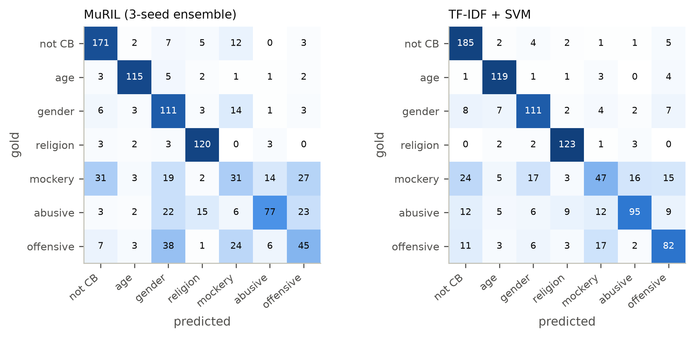

*Figure (fig:confusion). Confusion matrices on the official MC7 test set (counts; shading is row-normalised recall).*

Target-defined classes are easiest for MuRIL: `age` (F1 0.888) and
`religion` (0.860). The pragmatically or lexically defined classes
are hardest: `mockery` (0.288) and `offensive`
(0.396). Most confusions involve these two classes, for example
offensive→gender and mockery→not_cyberbullying (Figure \ref{fig:confusion}). This pattern matches the dataset's mixed
label semantics: an offensive remark about a woman is plausibly both "offensive" and "gender".

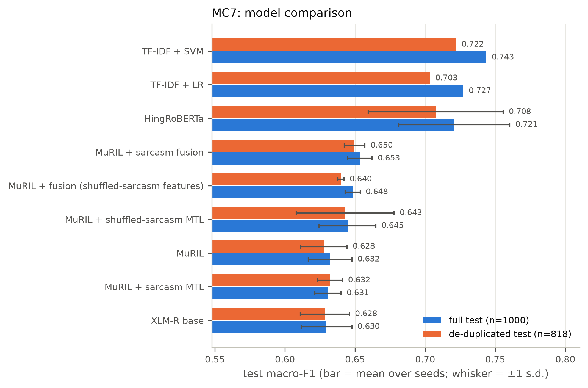

*Figure (fig:comparison). MC7 macro-F1 on the full official test set and on its de-duplicated subset. Transformers: mean ± s.d. over three seeds. The x-axis does not start at zero.*

### 9.4 Binary task (MC2)

**MC2 (binary cyberbullying): test-set results (mean ± s.d. over seeds; ensemble = mean of seed probabilities with bootstrap 95% CI; dedup = test items without near-duplicates in training).**

| Model | Seeds | Accuracy | Macro-F1 | Weighted-F1 | ROC-AUC | Macro-F1 (dedup test) | Ens. macro-F1 [95% CI] | ECE |
|---|---|---|---|---|---|---|---|---|
| Majority class | 1 | 0.800 | 0.444 | 0.711 | 0.500 | 0.441 | 0.444 [0.437, 0.452] | 0.002 |
| MuRIL | 3 | 0.912 ± 0.009 | 0.859 ± 0.006 | 0.911 ± 0.006 | 0.947 ± 0.006 | 0.867 ± 0.005 | 0.858 [0.830, 0.885] | 0.061 ± 0.017 |
| MuRIL + sarcasm fusion | 3 | 0.920 ± 0.008 | 0.872 ± 0.007 | 0.919 ± 0.006 | 0.939 ± 0.009 | 0.884 ± 0.009 | 0.873 [0.845, 0.898] | 0.053 ± 0.022 |
| MuRIL + sarcasm MTL | 3 | 0.904 ± 0.013 | 0.853 ± 0.016 | 0.905 ± 0.012 | 0.934 ± 0.009 | 0.860 ± 0.018 | 0.857 [0.828, 0.882] | 0.075 ± 0.011 |
| TF-IDF + LR | 1 | 0.925 | 0.879 | 0.924 | 0.960 | 0.876 | 0.879 [0.852, 0.904] | 0.025 |
| TF-IDF + SVM | 1 | 0.929 | 0.887 | 0.928 | 0.965 | 0.885 | 0.887 [0.859, 0.912] | 0.031 |
| XLM-R base | 3 | 0.910 ± 0.012 | 0.863 ± 0.017 | 0.911 ± 0.011 | 0.941 ± 0.006 | 0.871 ± 0.015 | 0.876 [0.850, 0.900] | 0.073 ± 0.009 |

For the derived binary task, TF-IDF SVM reaches 0.887 macro-F1 (ROC-AUC
0.965), against 0.859 ±
0.006 for MuRIL (ROC-AUC 0.947) and
0.863 ± 0.017 for XLM-R. Sarcasm MTL gives
0.853 ± 0.016 (Δ vs. base, seed ensemble:
-0.001, 95% CI [-0.021,
+0.020]) and fusion 0.872 ±
0.007 (Δ = +0.015, 95% CI
[-0.004, +0.034]). No fusion control
was run for MC2. Given the MC7 control result (Section 11), a fusion difference on MC2 should not be attributed to
sarcasm knowledge.

### 9.5 Calibration

Temperature scaling, fitted on validation logits, has mixed effects on the shifted test split. Test ECE falls for
XLM-R (0.152 → 0.063) and HingRoBERTa
(0.112 → 0.056), but not for MuRIL
(0.094 → 0.103; Figure \ref{fig:calibration}).
Temperatures fitted on in-distribution data therefore do not reliably transfer across the train–test shift, and
probabilities shown to moderators should be read as approximate.

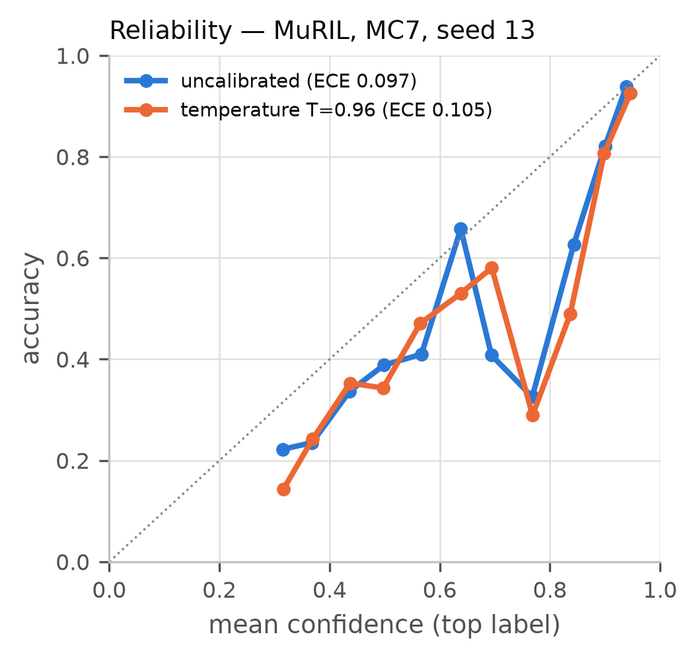

*Figure (fig:calibration). Reliability diagram for MuRIL on the MC7 test set before and after temperature scaling.*

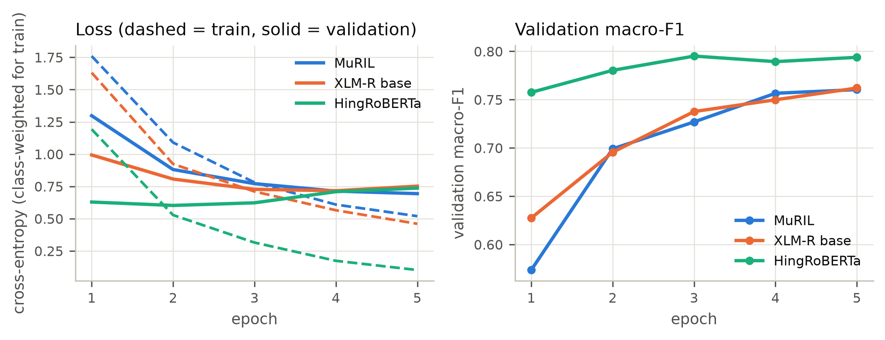

*Figure (fig:curves). Training/validation loss and validation macro-F1 per epoch (MC7, seed 13).*

## 10. Baseline Comparisons

Three observations follow from Tables \ref{tab:mc7}–\ref{tab:subsets} and the paired tests in Table \ref{tab:paired}.
First, the classical character-n-gram models are strong on this dataset. Our TF-IDF SVM
(0.743 macro-F1) is well above the 0.5475 F1 that Rahman-Laskar et al. (2024) report for
their SVM. The difference most plausibly comes from feature design (character 2–5-grams, class weighting, a tuned $C$); we
did not re-run their pipeline, so we make no stronger claim. Relative to MuRIL, the TF-IDF SVM is ahead by
+0.101 macro-F1 (95% CI [+0.072,
+0.130]). Second, the Hinglish-pretrained HingRoBERTa is the only transformer that
roughly matches the TF-IDF models on the official test split (ahead of MuRIL by
+0.091, 95% CI [+0.065,
+0.118]), and it has the largest seed variance (s.d.
0.040). Third, MuRIL and XLM-R are indistinguishable (Δ =
+0.011, 95% CI [-0.017,
+0.038]).

**Paired comparisons on the test set (B minus A). Bootstrap: 2,000 paired resamples of the seed-ensemble predictions; McNemar: exact test on per-item correctness. No multiple-comparison correction was applied; treat p-values as descriptive.**

| Comparison (B vs A) | Delta macro-F1 (ensemble) | 95% CI | p (bootstrap) | p (McNemar) | Seeds with Delta>0 |
|---|---|---|---|---|---|
| XLM-R base vs MuRIL | 0.011 | [-0.017, +0.038] | 0.460 | 0.771 | 1/3 |
| HingRoBERTa vs MuRIL | 0.091 | [+0.065, +0.118] | 0.000 | 0.000 | 3/3 |
| MuRIL + sarcasm MTL vs MuRIL | 0.006 | [-0.014, +0.026] | 0.552 | 0.744 | 2/3 |
| MuRIL + shuffled-sarcasm MTL vs MuRIL | 0.008 | [-0.010, +0.026] | 0.361 | 0.410 | 3/3 |
| MuRIL + sarcasm fusion vs MuRIL | 0.007 | [-0.013, +0.026] | 0.495 | 0.657 | 3/3 |
| TF-IDF + SVM vs MuRIL | 0.101 | [+0.072, +0.130] | 0.000 | 0.000 | 1/1 |
| TF-IDF + LR vs MuRIL | 0.085 | [+0.057, +0.113] | 0.000 | 0.000 | 1/1 |
| MuRIL + sarcasm MTL vs MuRIL + shuffled-sarcasm MTL | -0.002 | [-0.022, +0.017] | 0.821 | 0.741 | 1/3 |
| MuRIL + sarcasm fusion vs MuRIL + fusion (shuffled-sarcasm features) | -0.001 | [-0.019, +0.016] | 0.837 | 0.804 | 2/3 |
| XLM-R base vs MuRIL | 0.019 | [-0.006, +0.046] | 0.150 | 0.422 | 1/3 |
| MuRIL + sarcasm MTL vs MuRIL | -0.001 | [-0.021, +0.020] | 0.924 | 0.568 | 1/3 |
| MuRIL + sarcasm fusion vs MuRIL | 0.015 | [-0.004, +0.034] | 0.124 | 0.188 | 3/3 |
| TF-IDF + SVM vs MuRIL | 0.029 | [+0.001, +0.060] | 0.045 | 0.078 | 1/1 |
| MuRIL vs TF-IDF + LR | 0.067 | [+0.019, +0.115] | 0.003 | 0.326 | 1/1 |

## 11. Ablation Studies (RQ2)

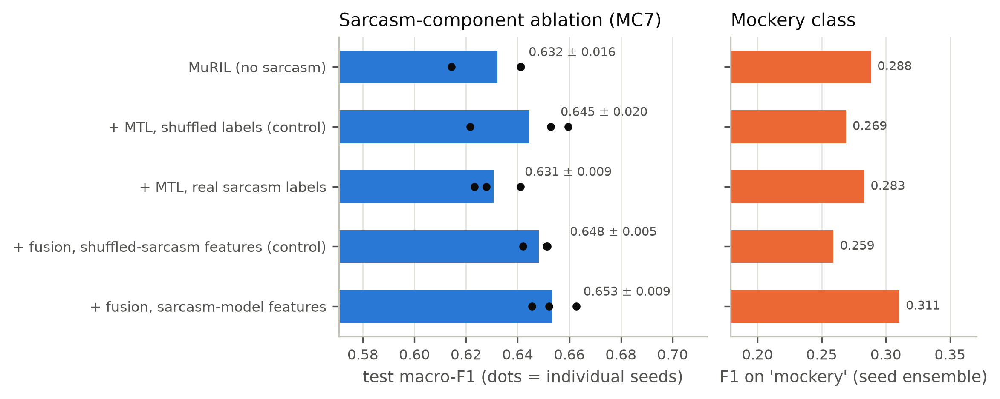

*Figure (fig:ablation). Ablation of sarcasm components on MC7 (MuRIL). Dots are individual seeds. The shuffled-label control receives the same auxiliary texts and loss as MTL, but with permuted sarcasm labels.*

**Multitask learning.** MuRIL with an auxiliary sarcasm head reaches 0.631 ±
0.009, against 0.632 ±
0.016 without it (seed-ensemble Δ = +0.006,
95% CI [-0.014, +0.026]). The shuffled-label
control, which receives identical auxiliary texts with permuted labels, scores 0.645
± 0.020. Real minus shuffled labels: Δ =
-0.002, 95% CI [-0.022,
+0.017]. The sarcasm labels therefore add nothing measurable. As a sanity
check, the auxiliary heads do learn sarcasm: on the Swami test split they reach macro-F1 0.787–0.794 with
real labels, versus 0.496–0.544 for the shuffled control, which is chance level as expected. The
sarcasm knowledge is acquired, but it does not transfer to cyberbullying-type decisions.

**Feature fusion.** Concatenating features from the separately trained sarcasm model gives
0.653 ± 0.009. The per-seed means are higher
than the base model in 3/3 seeds, but the seed-ensemble difference is
small and its interval includes zero (Δ = +0.007, 95% CI
[-0.013, +0.026]). A fusion control whose features come from a sarcasm model trained on permuted labels scores 0.648 ± 0.005; real vs. control features: no reliable difference (Δ = -0.001, 95% CI [-0.019, +0.016]). Any fusion effect is therefore not attributable to sarcasm knowledge.

**Mockery.** The class most associated with sarcasm stays the hardest under every variant (Figure \ref{fig:ablation},
right panel). Ensemble F1 on `mockery` is 0.288 for the base model,
0.283 with MTL and 0.311
with fusion.

**The prototype's boost rule.** We re-evaluated the additive boost on MC2 using the trained sarcasm detector (Table
\ref{tab:boost}). Mean macro-F1 is 0.859 for the unboosted classifier at threshold 0.50,
0.858 at the prototype's threshold of 0.55, and 0.859 with the boost.
Recall of the cyberbullying class is 0.950 → 0.951, and the
false-positive rate 0.245 → 0.247. 42.9% of MC test comments
reach the rule's 0.45 sarcasm threshold.

**Original SACENet additive sarcasm boost (p + 0.18*s if s >= 0.45; threshold 0.55) re-evaluated on MC2 with a trained sarcasm model, compared with the unboosted MuRIL classifier.**

| Seed | Setting | Macro-F1 | Recall (CB) | False-positive rate | Boosted items |
|---|---|---|---|---|---|
| 13 | base@0.50 | 0.854 | 0.940 | 0.230 | – |
| 13 | base@0.55 | 0.852 | 0.939 | 0.230 | – |
| 13 | boost@0.55 | 0.853 | 0.941 | 0.235 | 429 |
| 42 | base@0.50 | 0.859 | 0.931 | 0.190 | – |
| 42 | base@0.55 | 0.858 | 0.930 | 0.190 | – |
| 42 | boost@0.55 | 0.860 | 0.932 | 0.190 | 429 |
| 87 | base@0.50 | 0.866 | 0.981 | 0.315 | – |
| 87 | base@0.55 | 0.864 | 0.980 | 0.315 | – |
| 87 | boost@0.55 | 0.864 | 0.980 | 0.315 | 429 |

## 12. Explainability and Qualitative Analysis (RQ3)

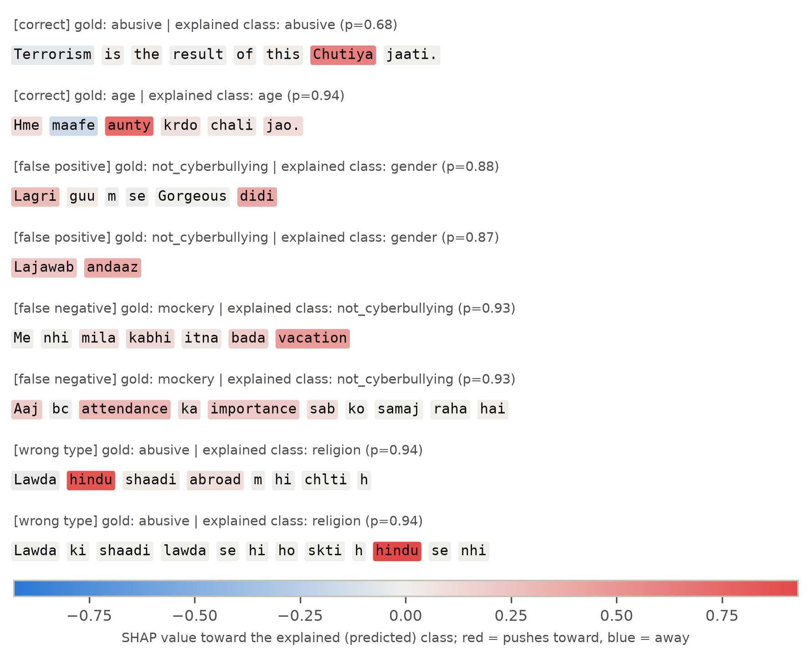

*Figure (fig:shap). Word-level SHAP attributions for MC7 test comments, explained with respect to the predicted class (red: toward; blue: away). Attributions describe model sensitivity, not author intent. Texts are shown as distributed.*

**Faithfulness.** Deleting the single word with the highest SHAP value lowers the predicted-class probability by
0.421 on average, against 0.092 for a random word (100 random
test comments). The difference is 0.329, with 95% CI [0.272,
0.385]. The top word beats a random one in a share of 0.860
of the comments, and the gap persists for $k=2,3$ (Figure \ref{fig:faith}, Table \ref{tab:xai}). By this deletion criterion,
the attributions identify words the model relies on.

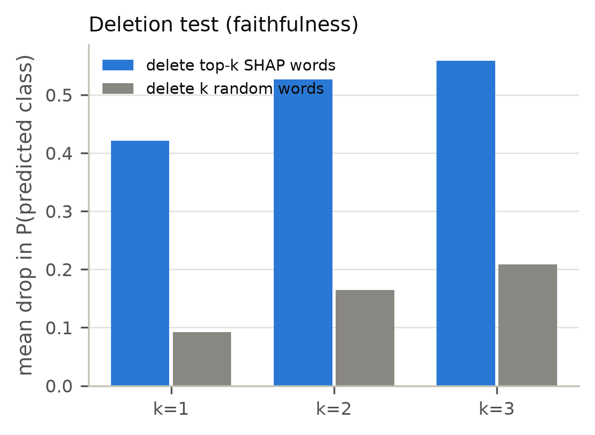

*Figure (fig:faith). Deletion test: drop in predicted-class probability after deleting the top-k SHAP words vs. k random words.*

**SHAP faithfulness, stability and overhead (MuRIL, MC7).**

| Measure | Value |
|---|---|
| deletion drop, top-1 vs random | 0.421 vs 0.092 (diff +0.329, 95% CI [+0.272, +0.385]; n=100) |
| deletion drop, top-2 vs random | 0.527 vs 0.164 (diff +0.363, 95% CI [+0.301, +0.425]; n=100) |
| deletion drop, top-3 vs random | 0.558 vs 0.209 (diff +0.349, 95% CI [+0.295, +0.403]; n=100) |
| rank stability: budget 100 vs 1000 | Spearman 0.950; top-3 overlap 0.83 (n=12) |
| rank stability: budget 250 vs 1000 | Spearman 0.986; top-3 overlap 0.94 (n=12) |
| rank stability: budget 500 vs 1000 | Spearman 0.997; top-3 overlap 0.97 (n=12) |
| SHAP vs leave-one-word-out occlusion | Spearman 0.273; top-3 overlap 0.57 (n=23) |
| time per explanation (cpu, 500 evals) | 0.87 s vs 23 ms inference (x38) |

**Stability and agreement.** Word rankings at 100 and 250 evaluations agree closely with a 1,000-evaluation reference
(Spearman 0.950 and 0.986). On these
short texts the explainer stops before 1,000 evaluations (525 were used for a 25-token comment), so the 500-vs-1,000
agreement is uninformative and not used as evidence. SHAP agrees only weakly with leave-one-word-out occlusion (Spearman
0.273, top-3 overlap 0.565). Single-word deletion ignores the
interactions that SHAP's coalitions capture, so the two methods answer different questions. No single attribution method
should be treated as ground truth.

**Qualitative pattern.** In the examples of Figure \ref{fig:shap}, identity and target terms receive the largest
attributions, including in errors. "hindu" dominates a *religion* prediction for a comment annotated *abusive*, and "didi"
(elder sister) drives a *gender* false positive on a harmless comment. This is consistent with reliance on identity terms,
a known source of bias in abuse classifiers (Sap et al., 2019). It is an observation from selected examples, not a
measured rate.

**Cost.** One explanation takes 0.9 s on CPU versus 23 ms for a prediction (×38).
That is acceptable for on-demand moderator review, but not for explaining every message in a stream.

**Error analysis.** Table \ref{tab:errors} breaks MuRIL's accuracy down by heuristic slice.

**Error analysis by heuristic slice (MuRIL seed ensemble, MC7 test).**

| Slice | N | Accuracy | Macro-F1 |
|---|---|---|---|
| test without near-duplicate in train | 818 | 0.678 | 0.638 |
| test WITH near-duplicate in train | 182 | 0.632 | 0.629 |
| short (<=8 words) | 503 | 0.746 | 0.659 |
| medium (9-20 words) | 471 | 0.611 | 0.607 |
| long (>20 words) | 26 | 0.269 | 0.262 |
| low English function-word ratio (<5%) | 727 | 0.688 | 0.609 |
| high English function-word ratio (>=15%) | 154 | 0.656 | 0.660 |
| no OOV words vs train vocabulary | 556 | 0.669 | 0.653 |
| OOV rate >= 30% (spelling/transliteration variation) | 34 | 0.647 | 0.617 |
| contains profanity | 260 | 0.604 | 0.581 |
| no profanity | 740 | 0.693 | 0.566 |
| sarcasm model P>=0.5 (model-inferred, not gold) | 410 | 0.612 | 0.546 |
| sarcasm model P<0.5 | 590 | 0.710 | 0.681 |

The clearest effects are length and the sarcasm model's prediction. Accuracy is
0.746 for comments of at most 8 words, 0.611 for 9–20
words, and 0.269 for the 26 comments longer than 20 words. Comments
the sarcasm model flags (P ≥ 0.5; n = 410) are classified less
accurately (0.612) than the rest
(0.710). This is consistent with indirect phrasing being harder, but the flag comes from
another model, not from gold labels. Out-of-vocabulary spelling shows no clear effect: accuracy is
0.647 for the
34 comments with at least 30% unseen word forms, versus
0.669 with none, but the slice is small. Only
4 non-bullying test comments contain a profane term, far too few to assess "friendly
profanity" false positives.

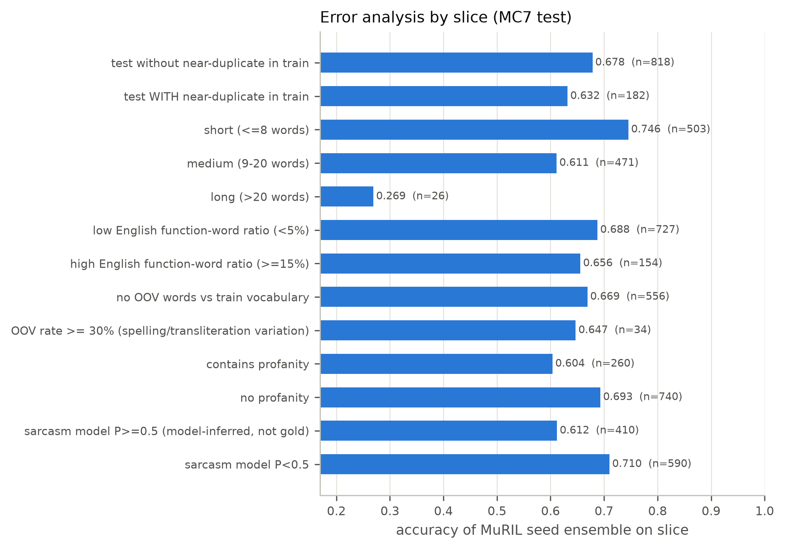

*Figure (fig:slices). Accuracy by heuristic slice (MuRIL seed ensemble, MC7 test).*

## 13. External Evaluation

**Cross-dataset evaluation without any re-training or threshold tuning. Label constructs differ from the training task (offensive language; differently sourced sarcasm), so these numbers measure transfer, not in-domain performance.**

| Test set | Model (trained on) | N | Macro-F1 (mean) | ROC-AUC (mean) | Runs |
|---|---|---|---|---|---|
| TweetEval-Offensive (en) | Majority class (MC2) | 860 | 0.218 | 0.500 | 1 |
| TweetEval-Offensive (en) | MuRIL (MC2) | 860 | 0.275 | 0.623 | 3 |
| TweetEval-Offensive (en) | MuRIL + sarcasm MTL (MC2) | 860 | 0.253 | 0.645 | 3 |
| TweetEval-Offensive (en) | TF-IDF + LR (MC2) | 860 | 0.235 | 0.544 | 1 |
| TweetEval-Offensive (en) | TF-IDF + SVM (MC2) | 860 | 0.253 | 0.552 | 1 |
| TweetEval-Offensive (en) | XLM-R base (MC2) | 860 | 0.317 | 0.678 | 3 |
| User sarcasm file (hi-en) | Majority class (Swami) | 8,455 | 0.363 | 0.500 | 1 |
| User sarcasm file (hi-en) | MuRIL (Swami) | 8,455 | 0.520 | 0.537 | 3 |
| User sarcasm file (hi-en) | TF-IDF + LR (Swami) | 8,455 | 0.448 | 0.443 | 1 |
| User sarcasm file (hi-en) | TF-IDF + SVM (Swami) | 8,455 | 0.433 | 0.450 | 1 |

Without re-training, the binary MC models transfer poorly to English offensive-language detection (TweetEval/OLID:
MuRIL macro-F1 0.275, ROC-AUC 0.623; TF-IDF SVM
0.253). This is expected: both the language and the label construct differ. The
Swami-trained sarcasm models reach macro-F1 0.520 (ROC-AUC
0.537) on the user-supplied, human-labelled sarcasm comments, close to chance.
The two sarcasm corpora therefore do not share a transferable notion of sarcasm, which is another reason the Swami-based
sarcasm signal may not help MC-Hinglish. The user corpus is reported only as a supplementary signal, because its provenance
is undocumented.

## 14. Early-Detection Evaluation (RQ4, proxy)

**Early-warning proxy evaluation on CONDA test conversations (running-max policy; thresholds chosen on validation).**

| Turn scorer | F1 | Precision | Recall | False-alarm rate | Mean delay | ERDE_3 | ERDE_5 | Recall @FAR<=0.10(val) | FAR @FAR<=0.10(val) |
|---|---|---|---|---|---|---|---|---|---|
| conda__distilroberta__base__s13 | 0.913 | 0.916 | 0.909 | 0.051 | 0.010 | 0.161 | 0.097 | 0.909 | 0.051 |
| conda__distilroberta__base__s42 | 0.910 | 0.930 | 0.890 | 0.041 | 0.071 | 0.165 | 0.101 | 0.890 | 0.041 |
| conda__distilroberta__base__s87 | 0.914 | 0.918 | 0.911 | 0.050 | 0.008 | 0.161 | 0.096 | 0.911 | 0.050 |
| conda__tfidf_lr | 0.912 | 0.928 | 0.897 | 0.043 | 0.022 | 0.165 | 0.098 | 0.897 | 0.043 |
| conda_ctx__distilroberta__base__s13 | 0.906 | 0.948 | 0.868 | 0.029 | 0.148 | 0.171 | 0.109 | 0.868 | 0.029 |
| conda_ctx__distilroberta__base__s42 | 0.910 | 0.926 | 0.894 | 0.044 | 0.070 | 0.165 | 0.101 | 0.894 | 0.044 |
| conda_ctx__distilroberta__base__s87 | 0.910 | 0.927 | 0.894 | 0.043 | 0.058 | 0.165 | 0.101 | 0.894 | 0.043 |
| conda_ctx__tfidf_lr | 0.853 | 0.824 | 0.884 | 0.116 | -0.044 | 0.179 | 0.118 | 0.849 | 0.083 |

On CONDA test conversations, a running-max alarm over DistilRoBERTa turn scores reaches alarm F1
0.913 with a false-alarm rate of
0.051 (seed 13; threshold chosen on validation). The mean delay is
0.010 turns after the first toxic turn; 651 of the 722 correct alarms have
zero delay. The procedure therefore detects toxicity **as it appears**, not before. Adding the two preceding turns as
context does not improve alarm quality for DistilRoBERTa, and it hurts TF-IDF (F1 0.853,
false-alarm rate 0.116). After seeing only the first turn,
0.463 of the eventually toxic conversations are already flagged, largely
because many conversations open with a toxic turn. These results concern English in-game chat. They show that the causal
evaluation machinery works on real sequential data, and they **do not validate early detection of Hinglish
cyberbullying**.

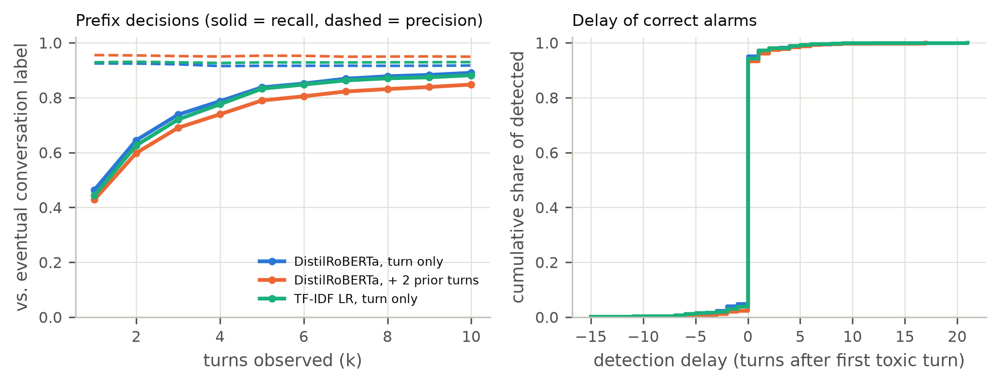

*Figure (fig:early). Early-warning proxy on CONDA: prefix decisions vs. eventual label, and delay of correct alarms.*

## 15. Discussion

**Why do transformers lose to TF-IDF on the official test split?** The domain classifier shows a strong shift between the
official training and test splits. Character n-grams generalise across spelling and transliteration variants by
construction. The fine-tuned encoders match the linear models in-distribution (validation) but lose about ten points on test.
HingRoBERTa, pretrained on Hinglish, narrows the gap, which suggests that the romanised-Hindi subword coverage of MuRIL and
XLM-R is part of the problem. Our compute-motivated choice to freeze the token-embedding table may also matter.
A diagnostic run with the token-embedding table unfrozen could not be completed: two attempts (batch 32, and batch 16 with 2-step gradient accumulation) drove the 16 GB machine to critical memory pressure and were stopped. Whether freezing contributes to the gap therefore remains open. We cannot fully separate these explanations.

**Is sarcasm-awareness useful?** On this dataset, as operationalised here, sarcasm supervision from the Swami corpus does
not improve cyberbullying-type classification, even though the models demonstrably learn sarcasm. Plausible reasons are the
gap between the sarcasm corpus (2017 tweets on a few topics, collected via hashtags) and MC-Hinglish, and the fact that
MC-Hinglish's `mockery` is a different construct from sarcasm. A fair test of the hypothesis requires sarcasm labels on the
cyberbullying data itself.

**Practical implications.** A calibrated, well-regularised linear model is a strong and cheap baseline that should be
reported alongside transformers for Hinglish abuse detection. Validation splits carved from training data can be misleading
when the official test split is shifted, so published comparisons on MC-Hinglish should report both.

## 16. Limitations and Ethical Considerations

- **Data.** MC-Hinglish is small, comes from a single platform, and reports no inter-annotator agreement. Its label set mixes
  target-, language- and style-based categories. The official test split is distribution-shifted and partly near-duplicated.
- **Tuning disclosure.** The learning-rate change described in Section 7 was triggered by an observed test result. The final
  hyperparameters are shared across models rather than tuned per model.
- **Compute.** The token-embedding table was frozen for all models; an unfrozen diagnostic exceeded the available memory
  (16 GB). Three seeds per configuration limit statistical power, and p-values are uncorrected and descriptive.
- **Sarcasm data.** The sarcasm corpus differs in period and topics from MC-Hinglish, and its retrieval hashtags had to be
  removed.
- **Early detection** was evaluated only on a proxy corpus with short, partially incomplete conversations.
- **Explanations** show model sensitivity, not intent or causation. Deletion-based faithfulness is one criterion among
  several, and SHAP and occlusion disagree substantially.
- **Ethics.** Cyberbullying classifiers can reproduce annotation and dialect biases (Sap et al., 2019). Errors on
  religion- and gender-related content can harm the communities involved. We recommend use only as decision support for
  trained moderators, with human review, no automated sanctions, and no profiling of individuals. The demo app does not
  store user text. Datasets are used under their licences and are not redistributed. Quoted examples are short and contain
  no user identifiers.

## 17. Conclusion and Future Work

We rebuilt SACENet as a reproducible, leakage-audited study of Hinglish cyberbullying-type detection. The evidence does not
support the prototype's central premise. Sarcasm supervision from a separate corpus does not improve detection, and a
shuffled-label control shows that what little the auxiliary task contributes is not sarcasm-specific. The strongest systems on
the official test split are character-n-gram linear models and a Hinglish-pretrained transformer. That split is measurably
shifted from the training data, which makes validation-based model comparisons unreliable. SHAP attributions are faithful
under a deletion test but disagree with occlusion. Early warning was only shown to detect toxicity at onset, and only on an
English proxy corpus. Future work should (i) annotate sarcasm and targets directly on Hinglish cyberbullying data, (ii) build
or obtain conversation-level Hinglish data with turn-level labels, (iii) study robustness to collection shift explicitly, and
(iv) evaluate how useful explanations are to moderators.

## References

- **[aggarwal2020sarcasm]** Aggarwal, Akshita; Wadhawan, Anshul; Chaudhary, Anshima; Maurya, Kavita (2020). "Did you really mean what you said?" : Sarcasm Detection in Hindi-English Code-Mixed Data using Bilingual Word Embeddings. *Proceedings of the Sixth Workshop on Noisy User-generated Text (W-NUT 2020)*. doi:10.18653/v1/2020.wnut-1.2
- **[barbieri2020tweeteval]** Barbieri, Francesco; Camacho-Collados, Jose; Espinosa Anke, Luis; Neves, Leonardo (2020). TweetEval: Unified Benchmark and Comparative Evaluation for Tweet Classification. *Findings of the Association for Computational Linguistics: EMNLP 2020*. doi:10.18653/v1/2020.findings-emnlp.148
- **[bohra2018hinglish]** Bohra, Aditya; Vijay, Deepanshu; Singh, Vinay; Akhtar, Syed Sarfaraz; Shrivastava, Manish (2018). A Dataset of Hindi-English Code-Mixed Social Media Text for Hate Speech Detection. *Proceedings of the Second Workshop on Computational Modeling of People's Opinions, Personality, and Emotions in Social Media*. doi:10.18653/v1/W18-1105
- **[caruana1997multitask]** Caruana, Rich (1997). Multitask Learning. *Machine Learning*. doi:10.1023/a:1007379606734
- **[conneau2020xlmr]** Conneau, Alexis; Khandelwal, Kartikay; Goyal, Naman; Chaudhary, Vishrav; Wenzek, Guillaume; Guzm\'an, Francisco; Grave, Edouard; Ott, Myle; Zettlemoyer, Luke; Stoyanov, Veselin (2020). Unsupervised Cross-lingual Representation Learning at Scale. *Proceedings of the 58th Annual Meeting of the Association for Computational Linguistics*. doi:10.18653/v1/2020.acl-main.747
- **[deyoung2020eraser]** DeYoung, Jay; Jain, Sarthak; Rajani, Nazneen Fatema; Lehman, Eric; Xiong, Caiming; Socher, Richard; Wallace, Byron C. (2020). ERASER: A Benchmark to Evaluate Rationalized NLP Models. *Proceedings of the 58th Annual Meeting of the Association for Computational Linguistics*. doi:10.18653/v1/2020.acl-main.408
- **[dietterich1998tests]** Dietterich, Thomas G. (1998). Approximate Statistical Tests for Comparing Supervised Classification Learning Algorithms. *Neural Computation*. doi:10.1162/089976698300017197
- **[fortuna2018survey]** Fortuna, Paula; Nunes, Sérgio (2018). A Survey on Automatic Detection of Hate Speech in Text. *ACM Computing Surveys*. doi:10.1145/3232676
- **[guo2017calibration]** Guo, Chuan; Pleiss, Geoff; Sun, Yu; Weinberger, Kilian Q. (2017). On Calibration of Modern Neural Networks. *Proceedings of the 34th International Conference on Machine Learning*. https://proceedings.mlr.press/v70/guo17a.html
- **[hosseinmardi2015instagram]** Hosseinmardi, Homa; Mattson, Sabrina Arredondo; Rafiq, Rahat Ibn; Han, Richard; Lv, Qin; Mishra, Shivakant (2015). Detection of Cyberbullying Incidents on the Instagram Social Network. *arXiv:1503.03909*.
- **[jacovi2020faithfulness]** Jacovi, Alon; Goldberg, Yoav (2020). Towards Faithfully Interpretable NLP Systems: How Should We Define and Evaluate Faithfulness?. *Proceedings of the 58th Annual Meeting of the Association for Computational Linguistics*. doi:10.18653/v1/2020.acl-main.386
- **[joshi2017sarcasm]** Joshi, Aditya; Bhattacharyya, Pushpak; Carman, Mark J. (2017). Automatic Sarcasm Detection: A Survey. *ACM Computing Surveys*. doi:10.1145/3124420
- **[khanuja2020gluecos]** Khanuja, Simran; Dandapat, Sandipan; Srinivasan, Anirudh; Sitaram, Sunayana; Choudhury, Monojit (2020). GLUECoS: An Evaluation Benchmark for Code-Switched NLP. *Proceedings of the 58th Annual Meeting of the Association for Computational Linguistics*. doi:10.18653/v1/2020.acl-main.329
- **[khanuja2021muril]** Khanuja, Simran; Bansal, Diksha; Mehtani, Sarvesh; Khosla, Savya; Dey, Atreyee; Gopalan, Balaji; Margam, Dilip Kumar; Aggarwal, Pooja; Nagipogu, Rajiv Teja; Dave, Shachi; Gupta, Shruti; Gali, Subhash Chandra Bose; Subramanian, Vish; Talukdar, Partha (2021). MuRIL: Multilingual Representations for Indian Languages. *arXiv:2103.10730*.
- **[koehn2004significance]** Koehn, Philipp (2004). Statistical Significance Tests for Machine Translation Evaluation. *Proceedings of the 2004 Conference on Empirical Methods in Natural Language Processing*. https://aclanthology.org/W04-3250/
- **[kumar2025murilxai]** Kumar, Devesh (2025). Cyberbullying Detection in Hinglish Text Using MURIL and Explainable AI. *arXiv:2506.16066*.
- **[kumar2018trac]** Kumar, Ritesh; Ojha, Atul Kr.; Malmasi, Shervin; Zampieri, Marcos (2018). Benchmarking Aggression Identification in Social Media. *Proceedings of the First Workshop on Trolling, Aggression and Cyberbullying (TRAC-2018)*. https://aclanthology.org/W18-4401/
- **[kumar2020trac2]** Kumar, Ritesh; Ojha, Atul Kr.; Malmasi, Shervin; Zampieri, Marcos (2020). Evaluating Aggression Identification in Social Media. *Proceedings of the Second Workshop on Trolling, Aggression and Cyberbullying*. https://aclanthology.org/2020.trac-1.1/
- **[losada2016erisk]** Losada, David E.; Crestani, Fabio (2016). A Test Collection for Research on Depression and Language Use. *Experimental IR Meets Multilinguality, Multimodality, and Interaction*. doi:10.1007/978-3-319-44564-9_3
- **[loshchilov2017adamw]** Loshchilov, Ilya; Hutter, Frank (2017). Decoupled Weight Decay Regularization. *arXiv:1711.05101*.
- **[lundberg2017shap]** Lundberg, Scott M.; Lee, Su-In (2017). A Unified Approach to Interpreting Model Predictions. *Advances in Neural Information Processing Systems*. https://proceedings.neurips.cc/paper_files/paper/2017/hash/8a20a8621978632d76c43dfd28b67767-Abstract.html
- **[lopezvizcaino2021early]** López-Vizcaíno, Manuel F.; Nóvoa, Francisco J.; Carneiro, Victor; Cacheda, Fidel (2021). Early detection of cyberbullying on social media networks. *Future Generation Computer Systems*. doi:10.1016/j.future.2021.01.006
- **[majumder2026smallwins]** Majumder, Bitan; Sen, Anirban (2026). Small Wins Big: Comparing Large Language Models and Domain Fine-Tuned Models for Sarcasm Detection in Code-Mixed Hinglish Text. *arXiv:2602.21933*.
- **[majumder2019sarcasmmtl]** Majumder, Navonil; Poria, Soujanya; Peng, Haiyun; Chhaya, Niyati; Cambria, Erik; Gelbukh, Alexander (2019). Sentiment and Sarcasm Classification With Multitask Learning. *IEEE Intelligent Systems*. doi:10.1109/mis.2019.2904691
- **[mandl2019hasoc]** Mandl, Thomas; Modha, Sandip; Majumder, Prasenjit; Patel, Daksh; Dave, Mohana; Mandlia, Chintak; Patel, Aditya (2019). Overview of the HASOC track at FIRE 2019: Hate Speech and Offensive Content Identification in Indo-European Languages. *Proceedings of the 11th Forum for Information Retrieval Evaluation*. doi:10.1145/3368567.3368584
- **[mathew2021hatexplain]** Mathew, Binny; Saha, Punyajoy; Yimam, Seid Muhie; Biemann, Chris; Goyal, Pawan; Mukherjee, Animesh (2021). HateXplain: A Benchmark Dataset for Explainable Hate Speech Detection. *Proceedings of the AAAI Conference on Artificial Intelligence*. doi:10.1609/aaai.v35i17.17745
- **[nayak2022hingbert]** Nayak, Ravindra; Joshi, Raviraj (2022). L3Cube-HingCorpus and HingBERT: A Code Mixed Hindi-English Dataset and BERT Language Models. *Proceedings of the WILDRE-6 Workshop within the 13th Language Resources and Evaluation Conference*. https://aclanthology.org/2022.wildre-1.2/
- **[pedregosa2011sklearn]** Pedregosa, Fabian; Varoquaux, Ga\"el; Gramfort, Alexandre; Michel, Vincent; Thirion, Bertrand; Grisel, Olivier; Blondel, Mathieu; Prettenhofer, Peter; Weiss, Ron; Dubourg, Vincent; Vanderplas, Jake; Passos, Alexandre; Cournapeau, David; Brucher, Matthieu; Perrot, Matthieu; Duchesnay, \'Edouard (2011). Scikit-learn: Machine Learning in Python. *Journal of Machine Learning Research*. http://jmlr.org/papers/v12/pedregosa11a.html
- **[laskar2024mchinglish]** Rahman-Laskar, Sahinur; Gupta, Gauri; Badhani, Ritika; Pinto-Avendaño, David Eduardo (2024). Cyberbullying Detection in a Multi-classification Codemixed Dataset. *Computación y Sistemas*. doi:10.13053/cys-28-3-4989
- **[ribeiro2016lime]** Ribeiro, Marco Tulio; Singh, Sameer; Guestrin, Carlos (2016). “Why Should I Trust You?”: Explaining the Predictions of Any Classifier. *Proceedings of the 22nd ACM SIGKDD International Conference on Knowledge Discovery and Data Mining*. doi:10.1145/2939672.2939778
- **[ruder2017mtl]** Ruder, Sebastian (2017). An Overview of Multi-Task Learning in Deep Neural Networks. *arXiv:1706.05098*.
- **[salawu2020survey]** Salawu, Semiu; He, Yulan; Lumsden, Joanna (2020). Approaches to Automated Detection of Cyberbullying: A Survey. *IEEE Transactions on Affective Computing*. doi:10.1109/taffc.2017.2761757
- **[sap2019racial]** Sap, Maarten; Card, Dallas; Gabriel, Saadia; Choi, Yejin; Smith, Noah A. (2019). The Risk of Racial Bias in Hate Speech Detection. *Proceedings of the 57th Annual Meeting of the Association for Computational Linguistics*. doi:10.18653/v1/P19-1163
- **[sundararajan2017ig]** Sundararajan, Mukund; Taly, Ankur; Yan, Qiqi (2017). Axiomatic Attribution for Deep Networks. *Proceedings of the 34th International Conference on Machine Learning*. https://proceedings.mlr.press/v70/sundararajan17a.html
- **[swami2018sarcasm]** Swami, Sahil; Khandelwal, Ankush; Singh, Vinay; Akhtar, Syed Sarfaraz; Shrivastava, Manish (2018). A Corpus of English-Hindi Code-Mixed Tweets for Sarcasm Detection. *arXiv:1805.11869*.
- **[vanhee2018cyberbullying]** Van Hee, Cynthia; Jacobs, Gilles; Emmery, Chris; Desmet, Bart; Lefever, Els; Verhoeven, Ben; De Pauw, Guy; Daelemans, Walter; Hoste, Véronique (2018). Automatic detection of cyberbullying in social media text. *PLOS ONE*. doi:10.1371/journal.pone.0203794
- **[vidgen2020directions]** Vidgen, Bertie; Derczynski, Leon (2020). Directions in abusive language training data, a systematic review: Garbage in, garbage out. *PLOS ONE*. doi:10.1371/journal.pone.0243300
- **[weld2021conda]** Weld, Henry; Huang, Guanghao; Lee, Jean; Zhang, Tongshu; Wang, Kunze; Guo, Xinghong; Long, Siqu; Poon, Josiah; Han, Caren (2021). CONDA: a CONtextual Dual-Annotated dataset for in-game toxicity understanding and detection. *Findings of the Association for Computational Linguistics: ACL-IJCNLP 2021*. doi:10.18653/v1/2021.findings-acl.213
- **[wolf2020transformers]** Wolf, Thomas; Debut, Lysandre; Sanh, Victor; Chaumond, Julien; Delangue, Clement; Moi, Anthony; Cistac, Pierric; Rault, Tim; Louf, Remi; Funtowicz, Morgan; Davison, Joe; Shleifer, Sam; von Platen, Patrick; Ma, Clara; Jernite, Yacine; Plu, Julien; Xu, Canwen; Le Scao, Teven; Gugger, Sylvain; Drame, Mariama; Lhoest, Quentin; Rush, Alexander (2020). Transformers: State-of-the-Art Natural Language Processing. *Proceedings of the 2020 Conference on Empirical Methods in Natural Language Processing: System Demonstrations*. doi:10.18653/v1/2020.emnlp-demos.6
- **[zampieri2019olid]** Zampieri, Marcos; Malmasi, Shervin; Nakov, Preslav; Rosenthal, Sara; Farra, Noura; Kumar, Ritesh (2019). Predicting the Type and Target of Offensive Posts in Social Media. *Proceedings of the 2019 Conference of the North American Chapter of the Association for Computational Linguistics: Human Language Technologies, Volume 1 (Long and Short Papers)*. doi:10.18653/v1/N19-1144
